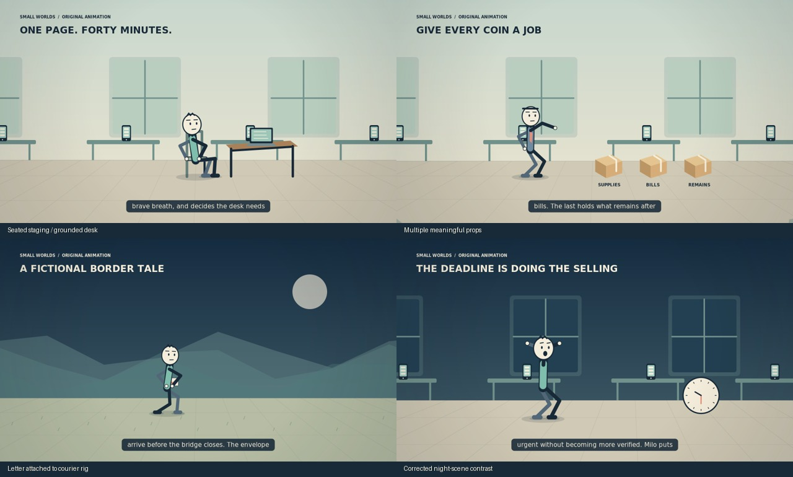
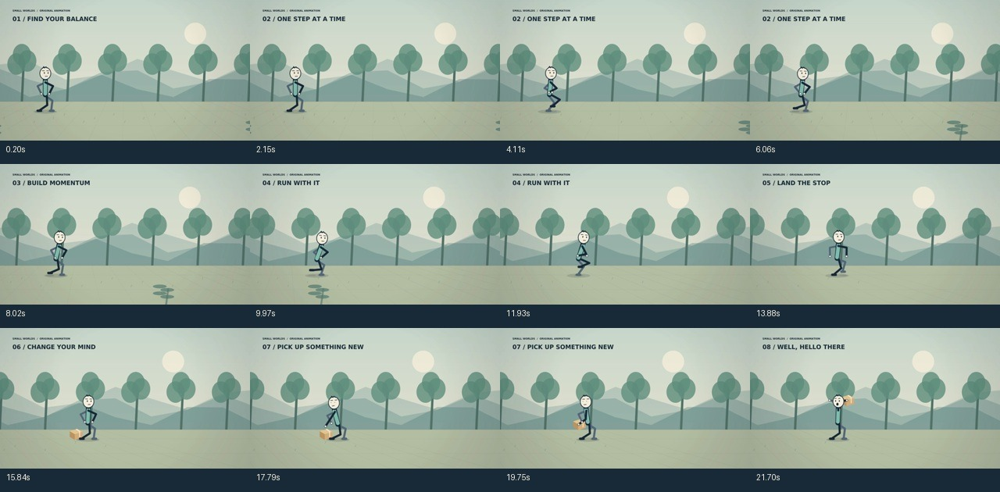

# Small Worlds — Cinematic Stickman Engine

An original CPU animation engine with a manually launched GitHub Actions pipeline.
It produces real H.264/AAC videos from validated scene plans, local Kokoro voiceover,
contact-aware skeletal motion, layered environments, procedural sound and measured QA.

**Status: working development engine, not professionally qualified autonomous filmmaking.**
The finite action library cannot visualize every arbitrary brief. Technical acceptance
and professional artistic acceptance are deliberately separate. See
[quality standards](docs/quality-standards.md) and [validation results](docs/validation.md).

[Download the benchmark, ten niche videos, automatic-writing example and reports](docs/deliverables.md).

## Run the two independent workflows

Open **Actions → Psychology — Independent Film** or **What-if Scenarios — Independent Film**.
Each has its own title, creative brief, duration, run, voice, story, storyboard, visuals and artifact.
Launch both workflows to run both niches concurrently. Neither waits for the other.
They share rendering code and immutable model downloads, never creative inputs or outputs.

The first two films are separately authored and directed in [episodes/](episodes/), with
[scripts and source notes](docs/episodes/). Both target five minutes, with an enforced
four-to-six-minute finish. Production renders are 1920×1080 at 60 FPS, with narration,
original procedural music and foley. Final artifacts contain the MP4, measured script,
storyboard, contact sheet, motion excerpt and technical QA report.

1. Enter this workflow's **video_title**, **video_description**, and **minutes** (default `5`).
2. Keep **quality: production** for the final render.
3. For a new story, leave **reviewed_plan_path** blank: the free local Qwen writer creates
   a new plan from those inputs. Supply reviewed **source_notes_path** for factual scripts;
   otherwise the generated story is labelled fiction. Small-model writing needs review.
4. To reproduce the first directed film, use `episodes/psychology.json` in the psychology
   workflow, or `episodes/what-if.json` in the what-if workflow. Keep that plan's exact
   title and description; the engine rejects mismatched inputs instead of relabelling it.
5. Download that run's film artifact at the bottom of its run page. Retention is 30 days.

Each niche has its own concurrency group. A later run of the same niche may queue;
psychology and what-if never serialize one another. Actual simultaneous execution also
requires two available GitHub runners. The tests workflow is separate infrastructure.
The previous comparison workflows are archived under `docs/archive/workflows/` and no
longer appear as production choices in Actions. Previous short samples are historical.

No paid API is required. GitHub account Actions minutes and storage quotas still apply.
Technical checks cannot certify storytelling or artistic quality; inspect the rendered
film before publication. Sources are reviewed context, not an automatic fact checker.

## Local setup

Python 3.12, FFmpeg/FFprobe, libcairo2 and DejaVu fonts. Linux is the tested platform.

```sh
python3.12 -m venv .venv
. .venv/bin/activate
pip install -r requirements.lock
pip install -e . --no-deps
pytest -q
stickfilm benchmark --out output/benchmark
stickfilm models
stickfilm produce --plan examples/plans/00.json --minutes 1.25 --out output/psychology
```

For automatic writing:

```sh
pip install -r requirements-writer.lock --only-binary llama-cpp-python \
  --extra-index-url https://abetlen.github.io/llama-cpp-python/whl/cpu
stickfilm models --local
stickfilm produce --title 'The Door That Only Opened After Lunch' \
  --brief 'A fictional office comedy. Milo thinks a door is broken. Ada finds a sign saying pull. A simple misunderstanding escalates, then has a visual payoff. Use the door prop and no factual claims.' \
  --minutes 0.6 --niche 'Relatable Comedy' --out output/door --preset preview
```

The local writer's approximately 2.5 GB model and 115 MB speech models are versioned and checksum
verified, cached in Actions, never checked into Git. The writer runs on two CPU
threads; larger models may improve writing but are not assumed available on hosted runners.

## Design

- `src/stickfilm/schema.py`: strict production IR and JSON schema.
- `motion.py`, `benchmark.py`: two-bone IK, distance gait, continuous benchmark.
- `drawing.py`, `world.py`, `render.py`: original rounded characters, 13 settings,
  three depth layers, camera tools, direct Cairo → FFmpeg stream, scene cache.
- `writer.py`: local-model JSON generation; `examples/plans`: authored fixtures.
- `voice.py`, `audio.py`: measured speech, narration ducking, original score/foley.
- `quality.py`: encoding, decode, duration, sound and motion gates; review images.
- `pipeline.py`, `cli.py`: production, preserved failure state, bounded retries.
- `.github/workflows/video-generator.yml`: manual production, benchmark, matrix,
  report aggregation and artifacts. `animation-tests.yml`: unit + real media tests.

[Architecture](docs/architecture.md) · [Setup](docs/setup.md) ·
[Troubleshooting](docs/troubleshooting.md) · [Licenses](assets/licenses/README.md)

## Rendered frame review



These frames demonstrate the implemented visual vocabulary, not professional
artistic qualification. The Actions artifacts contain actual playable MP4s.


