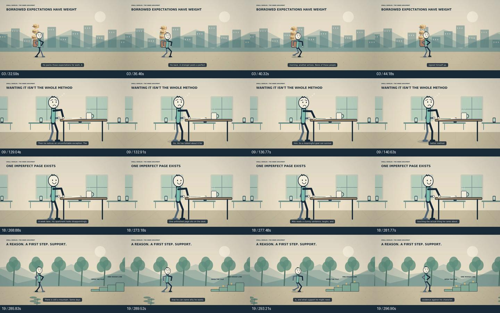
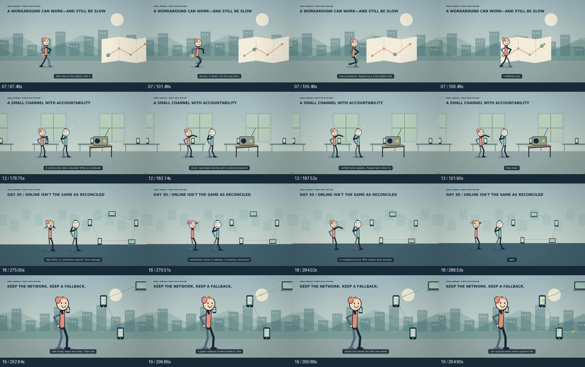

# Two independent films

These productions are separate stories, not two variants of a shared script.
Each workflow has its own inputs, run, voice, scene plan, storyboard and video artifact.

| Niche | Film | Story and direction |
|---|---|---|
| Psychology | Your Brain Isn't Lazy—Your Goals Might Be the Problem | Milo questions borrowed ambitions, chooses one meaningful project and writes one imperfect page. Warm paper tones, a wall of expectations, a burdened backpack, a mountain, and hands-on writing. |
| What-if scenarios | What If the Internet Disappeared for 30 Days? Cash Isn't Enough | Ada discovers that cash alone cannot coordinate a city. Cool city layers, network packets, a broken checkout, paper routes, radio bulletins and gradual reconnection. |

The psychology film uses `af_heart`; the what-if film uses `am_adam`. Both include
original procedural music, footsteps, sound effects, camera movement and estimated
caption chunks. Caption chunks are not forced-aligned word timestamps.

## Story review

- [Psychology script](psychology-script.md), [storyboard](psychology-storyboard.md), and [exact workflow inputs](psychology-inputs.json).
- [What-if script](what-if-script.md), [storyboard](what-if-storyboard.md), and [exact workflow inputs](what-if-inputs.json).
- [Reviewed source notes and scenario boundaries](research-notes.json), [public video descriptions](descriptions.md), and [refinement/review record](review.md).
- [Evidence that both production runs were in progress together](parallel-proof.json).

The psychology narrative is an original fictional illustration with narrowly sourced
claims about self-concordant goals and implementation intentions. It is not a diagnosis.
The what-if narrative is explicitly hypothetical; the dates and consequences are invented.
There is no claim that one real switch can disable the global Internet.

## Reproduce or change the next episode

Choose the relevant workflow in Actions. Its title and brief default to this first film.
For an exact reproduction set `reviewed_plan_path` to `episodes/psychology.json` or
`episodes/what-if.json` and keep that plan's exact title and brief. Set `minutes` to `5`
and quality to `production`. Run each workflow separately; both can run concurrently.

For a new title, leave the plan path blank and enter that workflow's own title and brief.
The local writer then creates a new story. Factual generation needs reviewed source notes;
without them it produces labelled fiction. The finite procedural animation library and
small local writer still require artistic review. No professional artistic rating is
claimed by the technical QA gates.

## Finished videos

Both production runs succeeded and their final artifacts were downloaded and checked.

| Niche | Title | Duration | Video |
|---|---|---:|---|
| Psychology | Your Brain Isn't Lazy—Your Goals Might Be the Problem | 5:16 | [Download video package](https://github.com/justsomeoneretarded/Stickman--films/actions/runs/39631423591/artifacts/12360572177) |
| What-if scenarios | What If the Internet Disappeared for 30 Days? Cash Isn't Enough | 5:24 | [Download video package](https://github.com/justsomeoneretarded/Stickman--films/actions/runs/39631428986/artifacts/12359014522) |

Both are H.264 MP4s at **1920×1080 / 60 FPS**, with stereo 48 kHz AAC audio.
Every technical check passed, including full decoding, duration, narration, black/freeze
screening, audio headroom and motion contacts. SHA-256 hashes, exact durations, job
start/end times and the individual checks are in [production-validation.json](production-validation.json).
Both jobs genuinely overlapped; the final file hashes, stories and niche metadata differ.

Each ZIP includes the title-named final MP4, its own script and storyboard, measured
scene plan, narration manifest, contact sheet, motion preview and QA/resource reports.
The ZIP links require access to this GitHub repository. GitHub retains these artifacts
for 30 days, with exact expiry times recorded in the validation JSON.

### Frames extracted from the final films

These are samples from the actual downloaded 1080p60 MP4s. The visual review scope and
remaining artistic limitations are stated in [review.md](review.md). No professional
artistic score is inferred from the passing technical gates.

