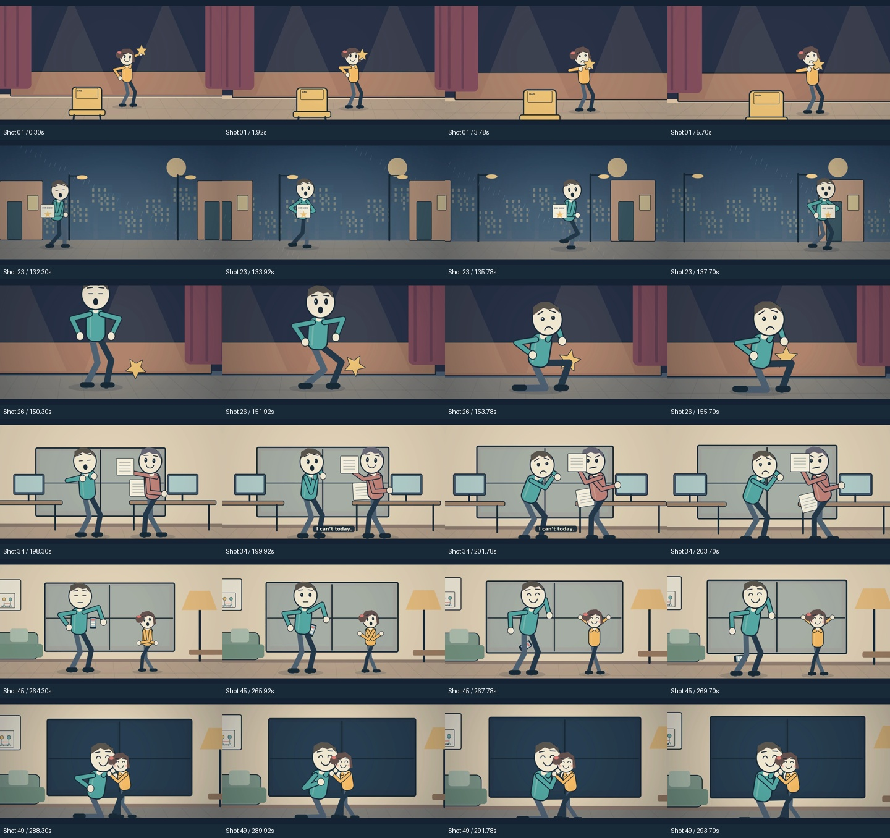
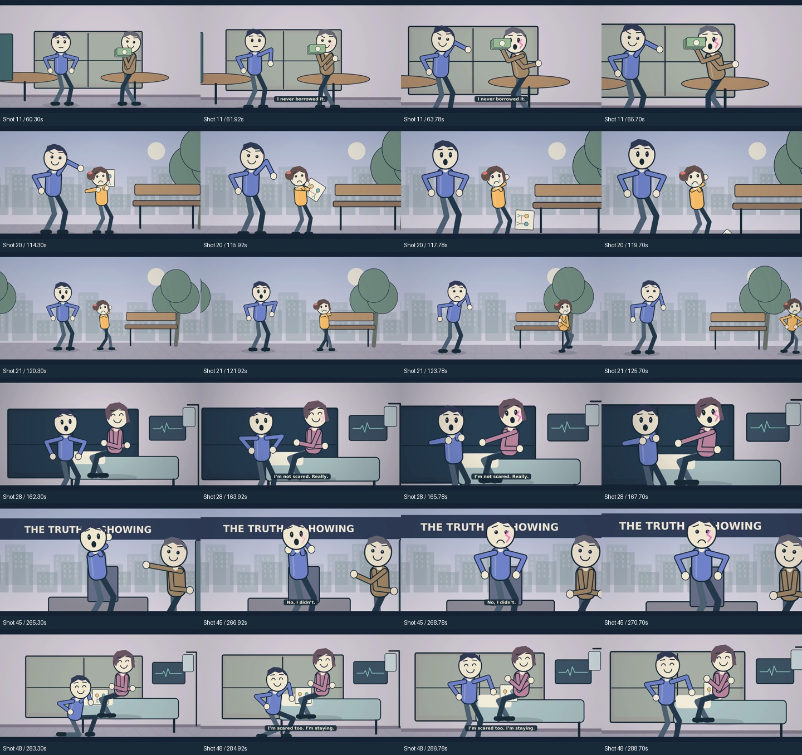

# Two rebuilt visual-story films

The first narrated explainers were rejected for weak scripts and small, repetitive
movement. These replacements use original stories, 50 directed shots each, larger
expressive characters, substantial movement, physical choices and sparse speech.

| Niche | New film | Screenplay | Storyboard |
|---|---|---|---|
| Psychology | They Loved Him More When He Was Useful | [Visible action + dialogue](psychology-v2-screenplay.md) | [50 shots](psychology-v2-storyboard.jpg) |
| What-if | What If Every Lie Left a Mark on Your Face? | [Visible action + dialogue](what-if-v2-screenplay.md) | [50 shots](what-if-v2-storyboard.jpg) |

Both are original fictional dramas. Each targets five minutes. The emotional story is
carried by behavior and consequences; the narration does not describe a static diagram.
See [the rebuild and review record](v2-review.md).

## Independent workflows

**Psychology — Independent Film** and **What-if Scenarios — Independent Film** have
separate titles, briefs, niche, run, concurrency group and video artifact. They share
rendering code and verified local models, never creative inputs or output folders.
Run both independently to process both at once.

The defaults now reproduce the new directed film for that niche. Exact inputs are
[psychology-inputs.json](psychology-inputs.json) and [what-if-inputs.json](what-if-inputs.json).
For another reviewed cinematic story, supply a plan with the matching title and brief.
Clearing the plan path invokes the experimental small local writer; it does not promise
the same quality of authored cinematic direction.

## Finished replacements

Both independent production workflows completed successfully and the final artifacts
were downloaded and checked. Each film is **5:00, 1920×1080, 60 FPS**, with stereo
48 kHz AAC audio.

| Film | Duration | Video |
|---|---:|---|
| They Loved Him More When He Was Useful | 5:00 | [Download final video package](https://github.com/justsomeoneretarded/Stickman--films/actions/runs/39750075506/artifacts/12414227176) |
| What If Every Lie Left a Mark on Your Face? | 5:00 | [Download final video package](https://github.com/justsomeoneretarded/Stickman--films/actions/runs/39750079590/artifacts/12414401752) |

Each ZIP contains the title-named final MP4, its measured script and storyboard,
a six-second preview, contact sheet, direction audit, media QA and resource reports.
Artifacts are retained for 30 days. Exact expiry, file hashes, start/end times and
passing checks are in [v2-production-validation.json](v2-production-validation.json).
[Parallel-run evidence](v2-parallel-proof.json) confirms separate jobs running together.

All 94 tests passed in GitHub CI. All final media and directed-action gates passed.
The cinematic direction gate does not claim legacy zero-sliding qualification.
Both downloaded final files also passed independent format, frame-rate, duration
and audio checks. See the [review scope and limitations](v2-review.md).

[Public video descriptions](v2-descriptions.md) · [Revised-draft validation](v2-draft-validation.json)

### Samples extracted from the actual final MP4s

Earlier links and validation files without the v2 designation refer to the rejected
first versions and remain historical. These downloads are the rebuilt films.
