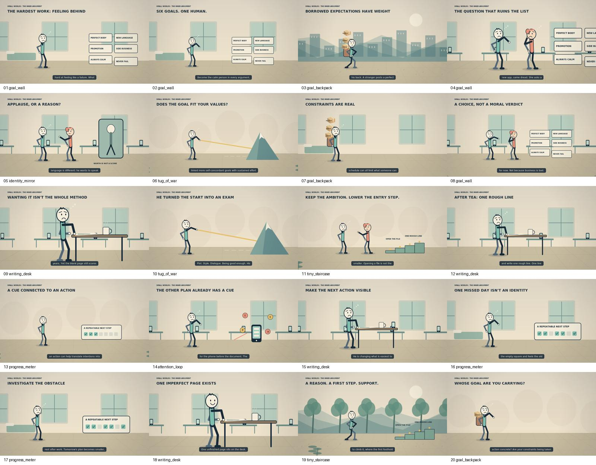

# Your Brain Isn't Lazy—Your Goals Might Be the Problem — storyboard

**01 / THE HARDEST WORK: FEELING BEHIND**

bedroom, warm; dolly-in; goal_wall. hero: frustrated.

**02 / SIX GOALS. ONE HUMAN.**

bedroom, warm; wide; goal_wall. hero: surprise.

**03 / BORROWED EXPECTATIONS HAVE WEIGHT**

city, warm; follow; goal_backpack. hero: walk.

**04 / THE QUESTION THAT RUINS THE LIST**

office, warm; over-shoulder; goal_wall. hero: think, friend: think.

**05 / APPLAUSE, OR A REASON?**

office, warm; dolly-in; identity_mirror. hero: point, friend: point.

**06 / DOES THE GOAL FIT YOUR VALUES?**

abstract, warm; wide; tug_of_war. hero: think.

**07 / CONSTRAINTS ARE REAL**

bedroom, warm; dolly-out; goal_backpack. hero: sad.

**08 / A CHOICE, NOT A MORAL VERDICT**

office, warm; wide; goal_wall. hero: point, friend: think.

**09 / WANTING IT ISN'T THE WHOLE METHOD**

office, warm; close-up; writing_desk. hero: write.

**10 / HE TURNED THE START INTO AN EXAM**

abstract, warm; dolly-out; tug_of_war. hero: point.

**11 / KEEP THE AMBITION. LOWER THE ENTRY STEP.**

abstract, warm; reveal; tiny_staircase. hero: point, friend: point.

**12 / AFTER TEA: ONE ROUGH LINE**

office, warm; over-shoulder; writing_desk. hero: write.

**13 / A CUE CONNECTED TO AN ACTION**

abstract, warm; wide; progress_meter. hero: point.

**14 / THE OTHER PLAN ALREADY HAS A CUE**

office, warm; dolly-in; attention_loop. hero: surprise.

**15 / MAKE THE NEXT ACTION VISIBLE**

office, warm; over-shoulder; writing_desk. hero: write.

**16 / ONE MISSED DAY ISN'T AN IDENTITY**

bedroom, warm; dolly-in; progress_meter. hero: sad.

**17 / INVESTIGATE THE OBSTACLE**

bedroom, warm; dolly-out; progress_meter. hero: think.

**18 / ONE IMPERFECT PAGE EXISTS**

office, warm; close-up; writing_desk. hero: write.

**19 / A REASON. A FIRST STEP. SUPPORT.**

forest, warm; follow; tiny_staircase. hero: walk.

**20 / WHOSE GOAL ARE YOU CARRYING?**

abstract, warm; dolly-out; goal_backpack. hero: think.
