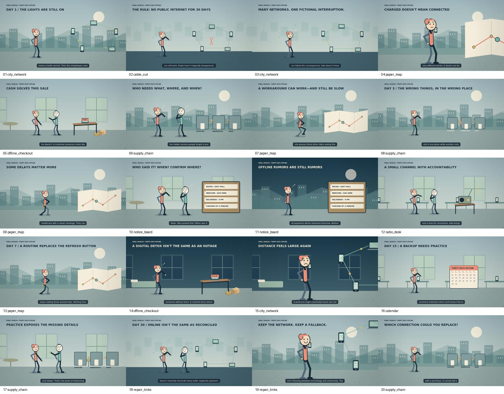

# What If the Internet Disappeared for 30 Days? Cash Isn't Enough — storyboard

**01 / DAY 1 / THE LIGHTS ARE STILL ON**

city, day; dolly-in; city_network. friend: surprise.

**02 / THE RULE: NO PUBLIC INTERNET FOR 30 DAYS**

digital, day; wide; cable_cut. friend: point.

**03 / MANY NETWORKS. ONE FICTIONAL INTERRUPTION.**

digital, day; reveal; city_network. friend: think.

**04 / CHARGED DOESN'T MEAN CONNECTED**

city, day; close-up; paper_map. friend: phone.

**05 / CASH SOLVES THIS SALE**

restaurant, day; wide; offline_checkout. friend: exchange, hero: point.

**06 / WHO NEEDS WHAT, WHERE, AND WHEN?**

city, day; dolly-out; supply_chain. friend: point, hero: think.

**07 / A WORKAROUND CAN WORK—AND STILL BE SLOW**

city, day; tracking; paper_map. friend: run.

**08 / DAY 3 / THE WRONG THINGS, IN THE WRONG PLACE**

city, day; wide; supply_chain. friend: think.

**09 / SOME DELAYS MATTER MORE**

city, day; follow; paper_map. friend: walk.

**10 / WHO SAID IT? WHEN? CONFIRM WHERE?**

restaurant, day; dolly-in; notice_board. friend: point, hero: think.

**11 / OFFLINE RUMORS ARE STILL RUMORS**

city, night; dolly-in; notice_board. friend: fear.

**12 / A SMALL CHANNEL WITH ACCOUNTABILITY**

office, day; wide; radio_desk. friend: point, hero: think.

**13 / DAY 7 / A ROUTINE REPLACES THE REFRESH BUTTON**

city, day; follow; paper_map. friend: walk.

**14 / A DIGITAL DETOX ISN'T THE SAME AS AN OUTAGE**

bedroom, night; dolly-out; offline_checkout. friend: sad.

**15 / DISTANCE FEELS LARGE AGAIN**

bedroom, night; close-up; city_network. friend: phone.

**16 / DAY 15 / A BACKUP NEEDS PRACTICE**

office, day; wide; calendar. friend: point.

**17 / PRACTICE EXPOSES THE MISSING DETAILS**

restaurant, day; dolly-in; supply_chain. friend: exchange, hero: point.

**18 / DAY 30 / ONLINE ISN'T THE SAME AS RECONCILED**

digital, day; reveal; repair_links. friend: surprise, hero: think.

**19 / KEEP THE NETWORK. KEEP A FALLBACK.**

city, day; close-up; repair_links. friend: phone.

**20 / WHICH CONNECTION COULD YOU REPLACE?**

city, day; wide; supply_chain. friend: think.
